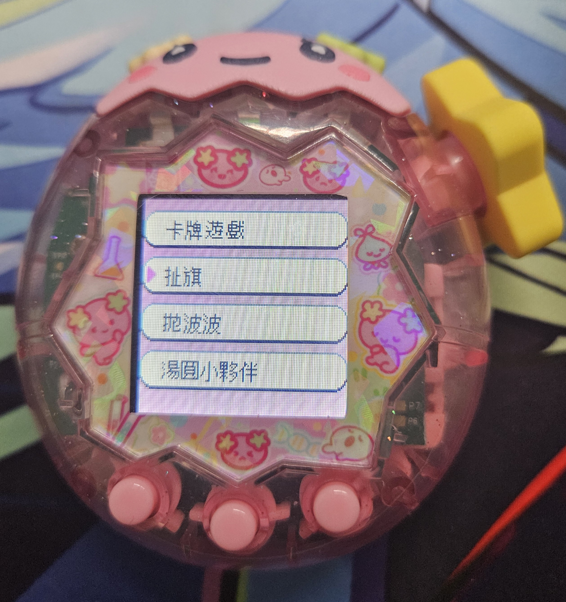
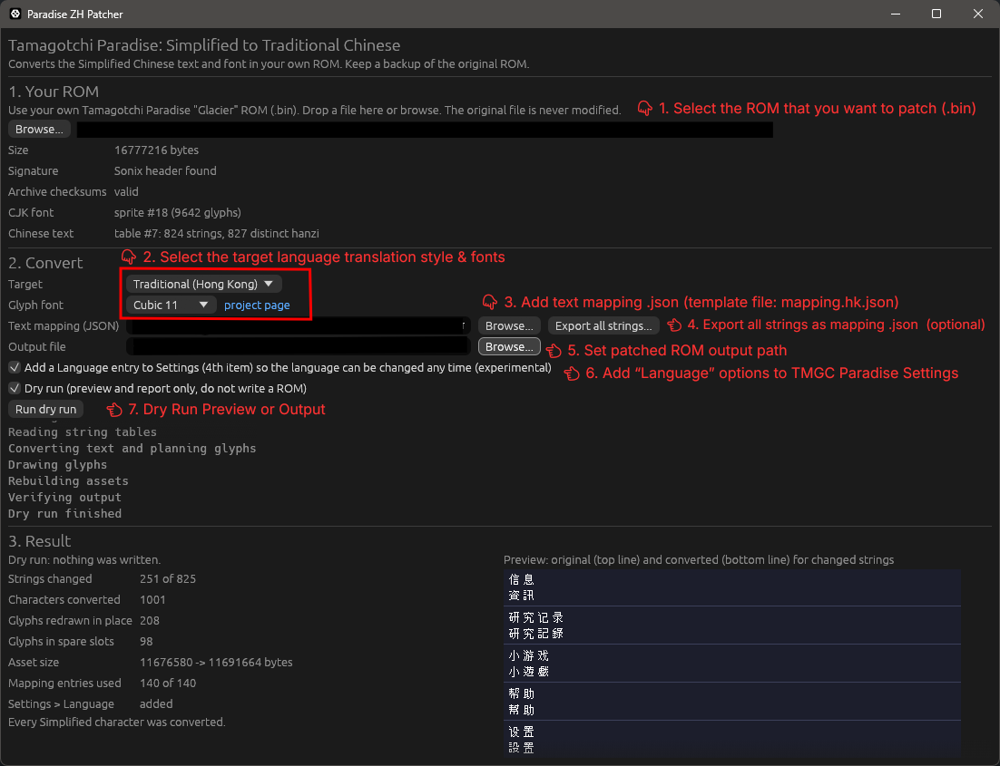
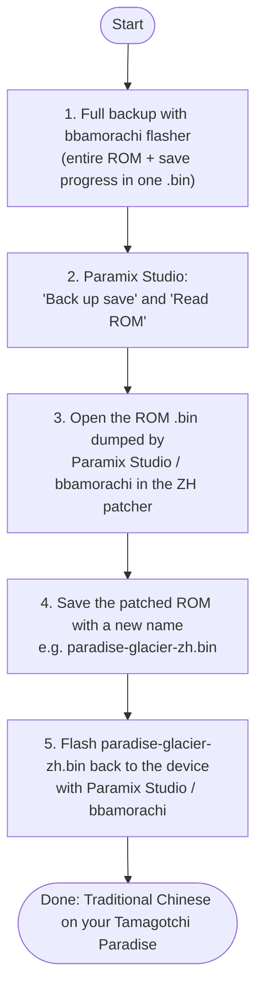

# Tamagotchi Paradise: Traditional Chinese ROM Patcher 繁體中文 Patcher

https://github.com/user-attachments/assets/d334540c-14fb-4485-b4cc-196fc8aa19d5

Converts the Simplified Chinese text and font in your own Tamagotchi Paradise ROM (`.bin`) to Traditional Chinese (Hong Kong by default) and writes a new ROM. No ROM or firmware is included or distributed; you supply your own dump.
The original file is never modified.

You can use the web version (wasm) here: https://paradise-zh-patcher.void-dojo.workers.dev/ or desktop app.

## What it does

- Converts every Chinese string in the ROM with OpenCC and rebuilds the archives (lengths, offsets, checksums), then verifies the result before writing.
- Gives each converted character a glyph:
  - An existing glyph is reused when the game's font already has the Traditional character.
  - Simplified-only characters (个, 们, 国) are redrawn in place.
  - Characters that are identical in Simplified and Traditional (定, 哦) are redrawn too, so every glyph comes from the chosen font instead of mixing it with the game's own. A character that another language also uses gets a spare slot instead of changing that language. Keep the game's original glyphs with `--keep-shared-glyphs` or by unchecking the GUI option.
  - Ambiguous characters (发 as 發 or 髮) keep the original slot for the most common reading; the others use spare slots taken from unused Korean Hangul codes.
  - Anything that cannot be handled keeps its Simplified glyph and is listed in the report.

New glyphs come from one of three pixel fonts (all SIL OFL 1.1), chosen with `--font` or the GUI's Glyph font list:

- `cubic11` (default): [Cubic 11](https://github.com/ACh-K/Cubic-11), 11x11 with Taiwan-style forms. Drawn at the top left of the 12x12 area, so it looks slightly smaller.
- `fusion`: [Fusion Pixel Font](https://github.com/TakWolf/fusion-pixel-font) 12px zh_hk. Built on Ark Pixel and matches the game's style.
- `ark`: [Ark Pixel Font](https://github.com/TakWolf/ark-pixel-font) 12px, with zh_hk, zh_tw or zh_hant forms to match the variant. A few dozen missing characters come from Fusion Pixel and are reported.

🚨 Text baked into images (title screens, menu art) is not converted.

## Target variants

| Target | CLI value | OpenCC | Difference |
|---|---|---|---|
| Traditional (Hong Kong) | `hk` (default) | `s2hk` | Standard Traditional plus Hong Kong forms. |
| Traditional (Taiwan) | `tw` | `s2tw` | Standard Traditional plus Taiwan forms. |
| Traditional (OpenCC standard) | `standard` | `s2t` | Plain character mapping, no regional forms. |

All three convert characters only; none rewrites vocabulary (软件 stays 軟件). In this game the differences are a handful of characters:

- Hong Kong: 牀, 麪, 裏, 着 (起牀, 麪包, 這裏, 試着). Taiwan: 床, 麵, 裡, 著.
- Taiwan writes 舞臺 and 擂臺; Hong Kong keeps 舞台 and 擂台.
- Standard keeps 爲, 喫 and 臺, where the regional variants use 為, 吃 and the forms above.

户 and 温, which OpenCC leaves unchanged, are always fixed to 戶 and 溫. To compare variants, export each with `paradise-cli strings <rom> --export x.json --variant <hk|tw|standard>`.

## Custom text mapping .json - Provide your own translation mapping (optional)



Nothing is hardcoded per string. To override wording, pass a JSON file of replacements, for example `mapping.hk.json`. Use it with `--mapping map.json` (CLI) or the "Text mapping (JSON)" field (GUI).

- Only the Chinese language table is changed. Keys that match nothing are reported.
- `^` at the start of a key matches only at the start of a string, `$` at the end only at the end. `<61440>` stands for the raw font code 61440 (a control code), so such codes can be kept or moved.
- To verify a patched ROM: `paradise-cli verify original.bin patched.bin --mapping map.json`.

### Export every string as a template

`paradise-cli strings <rom> --export map.json [--variant hk|tw|standard] [--grep text]` writes all distinct Chinese strings as whole-string entries (`"^设置$": "設置"`) with the converted text as the value. Edit the values you want to change; entries left as exported are ignored. Re-export if you change the variant. The GUI has an "Export all strings..." button next to the mapping field.

## Changing the language on Tamagotchi Paradise in runtime

https://github.com/user-attachments/assets/6a458ff1-11af-445e-888a-6f51d9bf7949


The firmware only offers the language screen on first boot. The patcher adds a "Language" entry (語言) as the fourth item of the Settings menu. Choosing a language there applies it immediately and returns to Settings, without repeating the first-boot date, birthday and planet-name screens. The Chinese entry in the language list is renamed from 中文（简体） to 中文（繁體）.

How it works: the patch moves the Settings menu table into unused flash, adds an entry that opens the existing language scene, appends a localized "language" label to every string table, and makes the language scene return to where it was opened from. It changes executable code, so it only applies to known firmware builds (Glacier, Tropical, Jade Forest, Sky, Water and Land); otherwise it is skipped and reported. Disable it with `--no-runtime-language` or the GUI checkbox.

## Verification status

Text and font changes are checked structurally (re-parse, checksums, only expected data changed, every used glyph drawn) and visually through the preview. The language entry was tested in the [Capybara](https://github.com/infinition/capybara) emulator and confirmed on real hardware. Keep a backup of your original ROM anyway.

## Build

Requires Rust 1.85 or newer.

```
cargo build --release
```

Binaries are placed in `target/release/`: `paradise-gui` and `paradise-cli`.

## GUI

Run `target/release/paradise-gui` OR visit https://paradise-zh-patcher.void-dojo.workers.dev/


## Guide to Flash patched ROM ✨



1. Use [bbamorachi flasher](https://tools.bbamorachi.us/flasher) to make a full backup of your Tamagotchi Paradise first. It backs up the entire ROM and your save progress in a single `.bin` file.
2. Use [Paramix Studio](https://mameise.github.io/Paramix-Studio/) to back up your game save ("Back up save" button) and dump the ROM ("Read ROM" button).
3. Open the ROM `.bin` dumped by Paramix Studio or bbamorachi in the ZH patcher.
4. Save the patched ROM under a new name, for example `paradise-glacier-zh.bin`.
5. Flash the patched ROM back to the device with Paramix Studio or bbamorachi.

## Web version (WebAssembly on Cloudflare Workers)

The GUI also builds to WebAssembly, so the patcher can run in a web page. The ROM is read and patched inside the browser and is never uploaded; the patched ROM is downloaded from the page.

Requires Node.js, the `wasm32-unknown-unknown` Rust target and `wasm-bindgen-cli` matching the `wasm-bindgen` version in `Cargo.lock`:

```
rustup target add wasm32-unknown-unknown
cargo install wasm-bindgen-cli --version <version in Cargo.lock> --locked
cd web
npm install
npm run dev      # builds, then serves http://localhost:8787 with wrangler
npm run deploy   # builds, then publishes to Cloudflare Workers
```

The Worker (`web/wrangler.jsonc`) only serves the built files from `web/dist` as static assets; there is no server-side code. Pushing a `v*` tag also deploys through `.github/workflows/deploy-web.yml`, which needs the repository secrets `CLOUDFLARE_API_TOKEN` and `CLOUDFLARE_ACCOUNT_ID`. To embed the page in another site, use an iframe:

```html
<iframe src="https://paradise-zh-patcher.<your-subdomain>.workers.dev" width="100%" height="900" style="border:0"></iframe>
```

Differences from the desktop app: the patch runs on the page's main thread, so the page pauses for a few seconds while working; the output is a browser download with a name you choose; and Chinese text in the report lists (unmatched mapping keys, unconverted characters) is shown as `U+XXXX` code points because the page has no CJK font. The WebAssembly file is about 13 MB, which the browser downloads once per update.

---

## Advanced - Development

### CLI Tool

```
paradise-cli inspect  <rom>
paradise-cli patch    <rom> [-o out.bin] [--variant hk|tw|standard] [--font cubic11|fusion|ark] [--mapping map.json] [--no-runtime-language] [--dry-run] [--force]
paradise-cli strings  <rom> [--grep text] [--export map.json] [--variant hk|tw|standard]
paradise-cli verify   <original> <patched> [--mapping map.json]
paradise-cli preview  <original> <patched> [-o preview.png] [--limit 40]
```

### Tests

```
cargo test
```

Set `PARADISE_ROM` to the path of your ROM to also run the integration tests (byte-identical rebuild, full patch and verification). They are skipped when it is unset.

```
$env:PARADISE_ROM = "C:\path\to\Tamagotchi_Paradise_Glacier.bin"; cargo test
```

### Regenerating the glyph packs

The files in `crates/paradise-core/assets/*.glyphs` are generated from the fonts' BDF files (Ark Pixel also has `zh_tw` and `zh_hant` BDFs, packed as `ark12_zh_tw.glyphs` and `ark12_zh_hant.glyphs`):

```
cargo run -p glyphpack-gen -- fusion-pixel-12px-monospaced-zh_hk.bdf crates/paradise-core/assets/fusion12_zh_hk.glyphs
cargo run -p glyphpack-gen -- ark-pixel-12px-monospaced-zh_hk.bdf crates/paradise-core/assets/ark12_zh_hk.glyphs
python tools/cubic11_to_bdf.py Cubic_11.ttf cubic11.bdf
cargo run -p glyphpack-gen -- cubic11.bdf crates/paradise-core/assets/cubic11.glyphs
```

### Project Folder Structure

- `crates/paradise-core`: ROM formats, conversion, glyph planning, patching, preview rendering.
- `crates/paradise-cli`: command line tool.
- `crates/paradise-gui`: egui desktop app.
- `crates/glyphpack-gen`: BDF to glyph pack converter.

--- 

## Licenses

- This project: MIT.
- Glyph bitmaps: Fusion Pixel Font, Ark Pixel Font and Cubic 11, SIL Open Font License 1.1. See `crates/paradise-core/assets/OFL-FusionPixel.txt`, `OFL-ArkPixel.txt` and `OFL-Cubic11.txt`.
- Conversion: [ferrous-opencc](https://github.com/apoint123/ferrous-opencc) and the [OpenCC](https://github.com/BYVoid/OpenCC) dictionaries, Apache-2.0.

Research on the ROM format by others: [GMMan/tama-para-research](https://github.com/GMMan/tama-para-research).
